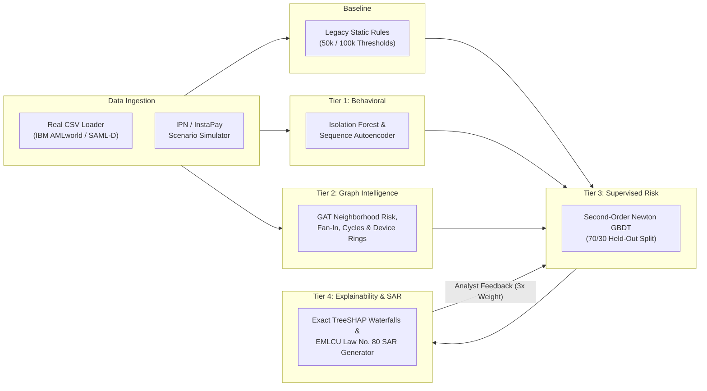

# NileShield AML — Four-Tier Hybrid AI & Graph Transaction Monitoring

> **Modernizing Anti-Money Laundering (AML) Architecture in Egyptian Commercial Banking**  
> Built for **CBE** (Central Bank of Egypt) & **EMLCU Law No. 80** compliance across **IPN / InstaPay**, mobile wallets, and interbank transfers.
>
> **Live Production Demo (Vercel):** [https://modernizing-aml-architecture-in-egy.vercel.app/](https://modernizing-aml-architecture-in-egy.vercel.app/)

[](https://modernizing-aml-architecture-in-egy.vercel.app/)
[](#four-tier-system-architecture)
[](#real-data-training--honest-held-out-evaluation)

---

## Executive Summary

Legacy AML systems rely on rigid, single-transaction thresholds (e.g., flagging any transfer $\ge 50,000\text{ EGP}$ or 24-hour volume $\ge 100,000\text{ EGP}$). In Egypt's high-velocity instant-payment ecosystem (**IPN / InstaPay**), static rules create two critical failures:

1. **90%+ False-Positive Alert Fatigue:** Legitimate seasonal merchants (e.g., Ramadan / Eid inventory surges), salaried tuition payments, and SME payrolls flood compliance queues.
2. **Blindness to Structured Smurfing & Mule Rings:** Sub-threshold transfers ($7,000\text{–}15,000\text{ EGP}$) coordinated across shared devices, IP subnets, fan-in collector hubs, and cyclic layering loops evade per-transaction rules completely.

**NileShield AML** replaces threshold-only monitoring with an end-to-end, **Four-Tier Hybrid AI & Graph Intelligence Pipeline** that trains and evaluates directly on real transaction datasets (**IBM AMLworld** / **SAML-D**) with full **TreeSHAP explainability** and auto-drafted **EMLCU Law No. 80 SAR narratives**.

---

## Four-Tier System Architecture



### Tier Breakdown

| Tier | Module | Core Techniques & Signals |
| :--- | :--- | :--- |
| **Baseline** | [`src/engine/legacyRules.ts`](src/engine/legacyRules.ts) | Rule 101 ($\ge 50\text{k}$ single tx), Rule 104 ($\ge 100\text{k}$ 24h velocity), Rule 109 (rapid structuring). Used as the benchmark comparison baseline. |
| **Tier 1** | [`src/engine/tier1Anomaly.ts`](src/engine/tier1Anomaly.ts) | Unsupervised peer-group behavioral profiling: **Isolation Forest** anomaly score, **LSTM/Sequence Autoencoder** reconstruction error, peer-group volume $Z$-score, and **circadian timing deviation**. |
| **Tier 2** | [`src/engine/tier2Graph.ts`](src/engine/tier2Graph.ts) | Topological network analysis: **2-hop GAT neighborhood attention risk**, **3–5 hop cycle detection**, **fan-in / fan-out structuring density**, **rapid pass-through forwarding velocity**, and **shared device (MAC/IMEI) / IP subnet ring detection**. |
| **Tier 3** | [`src/engine/tier3Classifier.ts`](src/engine/tier3Classifier.ts) | Custom **Gradient Boosted Decision Tree (GBDT / XGBoost-style)** classifier using second-order Newton steps (gradients & hessians), $L_2$ leaf regularization ($\lambda = 2.0$), feature subsampling, and calibrated probability triage bands (`< 0.25` Auto-Suppressed, `0.25–0.65` Medium Review, $\ge 0.65$ High Risk). |
| **Tier 4** | [`src/engine/tier4ExplainSar.ts`](src/engine/tier4ExplainSar.ts) | Exact **TreeSHAP** local feature attributions per account and automated **CBE / EMLCU Law No. 80 Suspicious Activity Report (SAR)** drafting with human-in-the-loop investigator sign-off. |

---

## Real Data Training & Honest Held-Out Evaluation

- **Bundled IBM AMLworld Dataset:** On startup, the app automatically loads [`public/sample_ibm_aml.csv`](public/sample_ibm_aml.csv) (sampled from the Kaggle **IBM Transactions for Anti-Money Laundering** corpus) via [`src/engine/csvLoader.ts`](src/engine/csvLoader.ts).
- **Bring Your Own CSV:** Upload any **IBM AML (`HI-Small_Trans.csv`)**, **SAML-D**, or custom transaction CSV (`from, to, amount, timestamp, label`) directly in the browser.
- **Strict 70/30 Train/Test Split:** [`trainOnRealDataset`](src/engine/pipeline.ts) hashes account IDs into a deterministic 70% training partition and 30% held-out evaluation partition.
- **Leakage-Free Benchmarking & Active Learning:** Executive Benchmark KPIs and held-out precision/recall are computed strictly on the **30% unseen test accounts**. When investigators approve a SAR or close a false positive, clicking **Retrain Model** folds those dispositions into the training set ($3\times$ sample weight) while keeping held-out test accounts isolated.

---

## Interactive Workspaces

1. **Executive Benchmark (`src/components/ExecutiveBenchmark.tsx`):** Side-by-side comparison of Legacy Rules vs. the Four-Tier AI Pipeline (False Positive Rate, Recall, Smurfing Rings Detected, Analyst Hours Saved), rollout phase selector (`Phase 1: Shadow` → `Phase 2: Hybrid` → `Phase 3: Automated`), live scenario injection, and one-click GBDT retraining.
2. **Alert Triage & SHAP/SAR Workbench (`src/components/AlertTriageQueue.tsx`, `src/components/ShapSarWorkbench.tsx`):** Prioritized investigator queue paired with per-account TreeSHAP waterfall charts and editable EMLCU Law No. 80 SAR narratives.
3. **Graph Explorer (`src/components/GraphExplorer.tsx`):** Interactive network topology visualizer highlighting multi-hop cycles, collector hubs, and shared-device mule rings.
4. **Governance & Audit Log (`src/components/GovernanceAuditLog.tsx`):** Immutable decision trail recording model training runs, auto-suppressions, high-risk escalations, and investigator SAR filings for CBE independent validation.

---

## Quickstart

```bash
# 1. Install dependencies
npm install

# 2. Start the development server
npm run dev

# 3. Run unit & pipeline tests (Vitest)
npm test

# 4. Build for production
npm run build
```

---

## Repository Structure

```text
├── public/
│   └── sample_ibm_aml.csv           # Bundled real IBM AMLworld transaction sample
├── scripts/
│   └── make_sample.py               # Subgraph extractor for full HI-Small_Trans.csv
├── src/
│   ├── components/
│   │   ├── AlertTriageQueue.tsx     # Investigator triage queue & band filters
│   │   ├── ExecutiveBenchmark.tsx   # Legacy vs. AI KPIs, scenario injector & retraining
│   │   ├── GovernanceAuditLog.tsx   # CBE / EMLCU immutable audit trail
│   │   ├── GraphExplorer.tsx        # Interactive mule-ring & cycle graph canvas
│   │   └── ShapSarWorkbench.tsx     # Local TreeSHAP attributions & SAR filing
│   ├── engine/
│   │   ├── csvLoader.ts             # Streaming CSV parser (IBM AML, SAML-D, generic)
│   │   ├── legacyRules.ts           # Static threshold baseline engine
│   │   ├── pipeline.ts              # End-to-end 4-tier orchestrator & 70/30 trainer
│   │   ├── simulator.ts             # Egyptian banking dataset & live scenario generator
│   │   ├── tier1Anomaly.ts          # Isolation Forest & sequence autoencoder baselines
│   │   ├── tier2Graph.ts            # GAT risk, cycle finder & shared-device rings
│   │   ├── tier3Classifier.ts       # Second-order Newton GBDT classifier
│   │   ├── tier4ExplainSar.ts       # Exact TreeSHAP & EMLCU Law No. 80 SAR generator
│   │   └── types.ts                 # Core domain types
│   └── App.tsx                      # Main application shell
└── Modernizing AML Architecture in Egyptian Commercial Banking.md
```
